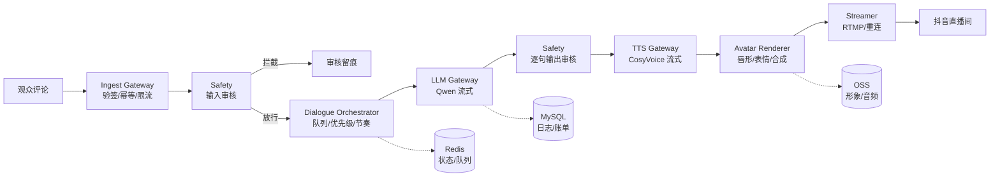
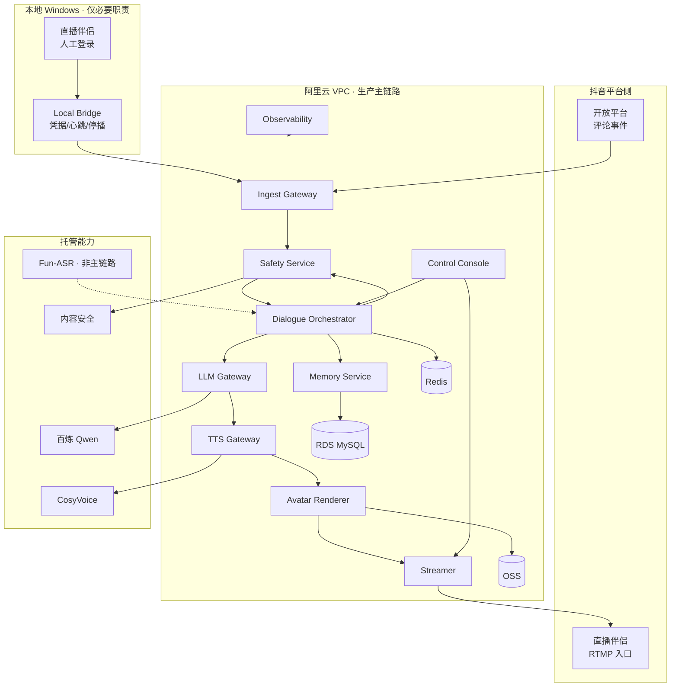

# StreamPilot · 直播领航员

**一套可管控、可审计、可接管的 AI 虚拟主播 / 直播 Agent 系统。**

StreamPilot 把「评论接入 → 内容安全 → 大模型回复 → 语音合成 → 数字人渲染 → RTMP 推流」串成一条可观测的实时链路，并配齐人设管理、场次调度、成本核算与人工接管控制台。

> 项目状态：**规划阶段（Phase 0）**。本仓库当前交付产品计划、架构与接口契约、任务拆分与工程基线，代码尚未落地。详见 [开发计划](docs/PLAN.md)。

---

## 目录

- [项目定位](#项目定位)
- [核心链路](#核心链路)
- [系统架构](#系统架构)
- [技术栈](#技术栈)
- [目录结构](#目录结构)
- [模块职责](#模块职责)
- [文档索引](#文档索引)
- [路线图](#路线图)
- [参与方式](#参与方式)
- [合规与安全声明](#合规与安全声明)
- [许可证](#许可证)

---

## 项目定位

StreamPilot 交付的是**AI 主播操作员**，不是「无人直播挂机工具」：

- AI 承担高频互动、欢迎、答疑与节奏维持；
- 人类负责开播决策、异常处置、合规复核与关键时刻接管；
- 系统为每一条对外内容保留生成与审核证据，做到「这句话为什么被说出来」可回放。

**适用**：品牌自播间、MCN 多间运营、持证虚拟形象创作者的常态化直播。
**不适用**：多账号批量养号、跨平台自动搬运、无人值守挂机、未授权形象与声音克隆。

完整目标、范围与验收指标见 [docs/PLAN.md](docs/PLAN.md#1-目标与边界)。

## 核心链路



设计要点：**流式优先**（LLM 与 TTS 不等全文）、**句级审核**、**单写者发声**、**安全 fail-closed**、**全链路可接管**。

## 系统架构



云端承担计算与编排；本地 Windows 只做无法上云的账号登录与推流凭据桥接。技术细节见 [docs/ARCHITECTURE.md](docs/ARCHITECTURE.md)。

## 技术栈

| 层次 | 选择 |
| --- | --- |
| 服务端 | Python 3.12 · FastAPI · Pydantic v2 |
| 前端控制台 | React · TypeScript · Vite · Tailwind CSS |
| 消息与状态 | Redis 7（Streams / ZSet / TTL） |
| 关系存储 | MySQL 8（RDS） |
| 对象存储 | 阿里云 OSS |
| 生成模型 | 百炼 Qwen（qwen-plus / qwen-turbo / qwen-max） |
| 语音合成 | CosyVoice（百炼，流式） |
| 语音识别 | Fun-ASR（百炼，非主链路） |
| 内容安全 | 阿里云内容安全 + 本地 DFA 词库 + 模型兜底 |
| 媒体管线 | FFmpeg · GStreamer |
| 部署 | Docker Compose（单间）→ ACK（多间） · Terraform |
| 观测 | OpenTelemetry · Prometheus · Grafana · 阿里云 SLS |
| CI/CD | GitHub Actions |

选型理由与备选对比见 [docs/PLAN.md](docs/PLAN.md#3-技术选型及理由)。

## 目录结构

```
streampilot/
├── README.md
├── .gitignore
├── .env.example              # 环境变量模板（真实密钥只放 .env，不入库）
├── docs/                     # 产品计划、架构、契约、部署、合规、成本
│   ├── PLAN.md
│   ├── ARCHITECTURE.md
│   ├── API.md
│   ├── DATA-MODEL.md
│   ├── DEPLOYMENT.md
│   ├── COMPLIANCE.md
│   ├── COST.md
│   ├── TASKS.md
│   └── adr/                  # 架构决策记录
├── services/                 # 云端服务（规划）
│   ├── ingest-gateway/
│   ├── safety/
│   ├── orchestrator/
│   ├── llm-gateway/
│   ├── tts-gateway/
│   ├── avatar-renderer/
│   └── streamer/
├── apps/
│   ├── control-console/      # Web 控制台（规划）
│   └── local-bridge/         # Windows 本地凭据桥（规划）
├── packages/
│   └── contracts/            # 跨服务 JSON Schema（规划）
├── infra/
│   ├── terraform/            # 阿里云资源定义（规划）
│   └── docker/               # 本地与单机部署（规划）
└── tests/
    ├── e2e/                  # 端到端演练（规划）
    └── evals/                # 对话与安全评测集（规划）
```

> `services/` `apps/` `packages/` `infra/` 下的代码目录将在 M1 起按任务清单逐步创建。当前阶段不提交空目录。

## 模块职责

| 模块 | 职责 | 不负责 |
| --- | --- | --- |
| Ingest Gateway | 平台回调、验签、幂等、限流、事件规范化 | 业务判断、审核决策 |
| Safety Service | 输入/输出双向审核、分级处置、熔断、留痕 | 生成文案 |
| Dialogue Orchestrator | 会话状态机、发言队列、优先级、节奏、打断 | 直接调用 TTS、直接推流 |
| LLM Gateway | 模型路由、提示词组装、流式输出、重试降级、token 记账 | 人设运营 |
| Memory Service | 短期上下文、长期摘要、观众标签、去重 | 内容审核 |
| TTS Gateway | 流式合成、文本规范化、音频缓存、字符计费 | 唇形计算 |
| Avatar Renderer | 唇形/表情/动作驱动、画面合成、AIGC 标识叠加 | 推流协议 |
| Streamer | RTMP 推流、码率自适应、断流重连 | 内容生成 |
| Control Console | 场次与人设管理、监控、人工接管、审核复核、成本 | 直接改运行时内存 |
| Local Bridge | 直播伴侣登录辅助、推流地址上行、心跳、一键停播 | 内容生成与存储 |

## 文档索引

| 文档 | 内容 |
| --- | --- |
| [PLAN.md](docs/PLAN.md) | 产品级开发计划：目标边界、架构、选型、数据模型、接口、延迟预算、部署、里程碑、风险合规、成本 |
| [ARCHITECTURE.md](docs/ARCHITECTURE.md) | 组件边界、时序、延迟拆解、失败模式、扩展路径 |
| [API.md](docs/API.md) | 接口契约、签名与幂等、错误码、内部事件 |
| [DATA-MODEL.md](docs/DATA-MODEL.md) | 表结构、索引、Redis 键、留存策略 |
| [DEPLOYMENT.md](docs/DEPLOYMENT.md) | 云上拓扑、资源规格、发布回滚、应急 Runbook |
| [COMPLIANCE.md](docs/COMPLIANCE.md) | 法规映射、审核策略、上线检查表、事故 SOP |
| [COST.md](docs/COST.md) | 成本假设、单价、档位、优化手段 |
| [TASKS.md](docs/TASKS.md) | Issue 级任务拆分与关键路径 |
| [adr/](docs/adr/README.md) | 架构决策记录 |

## 路线图

| 里程碑 | 目标 | 出口条件（摘要） |
| --- | --- | --- |
| M0 | 合规与资质就绪 | 平台能力确认 · 形象/音色授权 · AIGC 标识 · 推流合规结论 |
| M1 | 工程底座 | CI 全绿 · IaC 可重建 · 密钥零入库 · 观测可用 |
| M2 | 接入与安全闭环 | 万条回放正确 · 漏放 < 0.1% · 审核故障 fail-closed |
| M3 | 对话内核 | 4h 模拟不失控 · 离线评测评级达标 · 成本可归集 |
| M4 | 语音与数字人 | 首帧音频 p95 ≤ 3.5s · 音画同步 ≤ 80ms · 标识常驻 |
| M5 | 推流与接管 | 8h 稳定 · 断流 ≤ 15s 恢复 · 接管 ≤ 3s |
| M6 | 单间灰度 | 影子采纳率 ≥ 80% · 连续 5 场无 P0/P1 · 四类演练通过 |
| M7 | 产品化与多间 | 3 间并行 · 故障隔离 · 复盘自动化 · 租户 1h 接入 |

完整验收标准见 [docs/PLAN.md](docs/PLAN.md#8-里程碑与验收标准) 与 [docs/TASKS.md](docs/TASKS.md)。

## 参与方式

项目处于规划期，欢迎以下形式的参与：

1. **评审计划**：对 [PLAN.md](docs/PLAN.md) 的范围、延迟预算、成本假设提出质疑与修正。
2. **认领任务**：从 [TASKS.md](docs/TASKS.md) 选择带 `prio:p0` 且依赖已满足的任务，在 Issue 中说明方案后再动手。
3. **补充合规视角**：平台规则、深度合成标识、肖像与声音授权的落地细节。
4. **提交评测样本**：对话质量与内容安全的测试集（注意脱敏，勿提交真实用户信息）。

约定：一个 PR 只做一件事；提交信息使用 `type(scope): description`；涉及密钥的文件一律不入库；破坏性接口变更需先改契约并升版本。

## 合规与安全声明

- 本项目仅通过**平台官方开放能力**接入，明确反对抓包、逆向、群控、模拟点击等非官方手段。
- AI 生成内容必须**显著标识**；虚拟形象与音色必须**有书面授权**，禁止仿冒名人。
- 系统内置人工接管、断流重连与敏感词熔断，但**不承诺零人工值守**，运营方必须安排人工监看。
- 仓库不包含任何真实密钥、账号、密码或推流地址；请使用 `.env`（已忽略）与 `.env.example` 模板。
- 使用者应自行确保其直播内容符合所在地法律法规与平台规则。

详见 [docs/COMPLIANCE.md](docs/COMPLIANCE.md)。

## 许可证

**尚未确定。** 仓库暂不包含 `LICENSE` 文件。候选方案：

| 许可证 | 特点 | 适用倾向 |
| --- | --- | --- |
| MIT | 极简、宽松，允许闭源商用，仅保留版权与许可声明 | 希望最大化采用与生态扩散 |
| Apache-2.0 | 宽松 + 明确的专利授权与商标条款，需保留 NOTICE | 希望兼顾商用友好与专利保护 |

在许可证确定前，默认保留所有权利。请勿在未获授权的情况下将本项目用于商业分发。

---

**StreamPilot** — 让 AI 主播可控、可审计、可接管。
