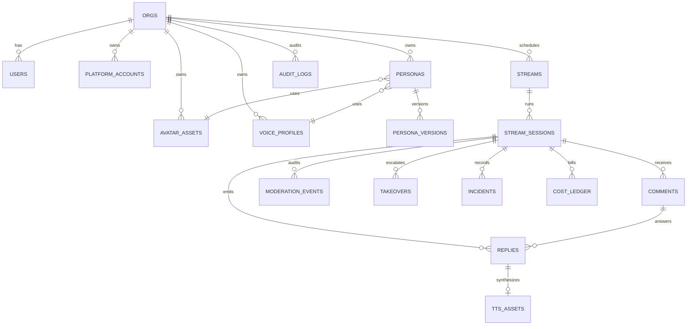

# StreamPilot 数据模型

> 存储分层见 [PLAN.md](PLAN.md#4-数据模型)；接口字段见 [API.md](API.md)。
> 约定：MySQL 8 / InnoDB / `utf8mb4`；主键为 `CHAR(26)` ULID；所有表含 `created_at`、`updated_at`；软删除用 `deleted_at`（仅配置类表）。

## 1. 实体关系



## 2. 核心表

### 2.1 租户与账号

```sql
CREATE TABLE orgs (
  id            CHAR(26) PRIMARY KEY,
  name          VARCHAR(128) NOT NULL,
  plan          VARCHAR(32)  NOT NULL DEFAULT 'standard',
  status        VARCHAR(16)  NOT NULL DEFAULT 'active',
  created_at    DATETIME(3)  NOT NULL,
  updated_at    DATETIME(3)  NOT NULL
);

CREATE TABLE users (
  id            CHAR(26) PRIMARY KEY,
  org_id        CHAR(26) NOT NULL,
  email         VARCHAR(255) NOT NULL,
  role          VARCHAR(32) NOT NULL,      -- owner/admin/operator/reviewer
  mfa_enabled   TINYINT(1) NOT NULL DEFAULT 0,
  created_at    DATETIME(3) NOT NULL,
  updated_at    DATETIME(3) NOT NULL,
  UNIQUE KEY uk_users_email (email),
  KEY idx_users_org (org_id)
);

CREATE TABLE platform_accounts (
  id                CHAR(26) PRIMARY KEY,
  org_id            CHAR(26) NOT NULL,
  platform          VARCHAR(32) NOT NULL,   -- douyin
  account_ref       VARCHAR(128) NOT NULL,  -- 平台侧账号标识（脱敏）
  qualification_ref VARCHAR(255) NOT NULL,  -- 资质材料引用（OSS 私有路径）
  status            VARCHAR(16) NOT NULL,   -- pending/active/expired/revoked
  expires_at        DATETIME(3) NULL,
  created_at        DATETIME(3) NOT NULL,
  updated_at        DATETIME(3) NOT NULL,
  KEY idx_pa_org (org_id),
  UNIQUE KEY uk_pa_account (platform, account_ref)
);
```

### 2.2 人设与资产

```sql
CREATE TABLE personas (
  id                CHAR(26) PRIMARY KEY,
  org_id            CHAR(26) NOT NULL,
  name              VARCHAR(128) NOT NULL,
  current_version_id CHAR(26) NULL,
  avatar_asset_id   CHAR(26) NOT NULL,
  voice_profile_id  CHAR(26) NOT NULL,
  status            VARCHAR(16) NOT NULL DEFAULT 'draft',
  created_at        DATETIME(3) NOT NULL,
  updated_at        DATETIME(3) NOT NULL,
  KEY idx_personas_org (org_id)
);

CREATE TABLE persona_versions (
  id              CHAR(26) PRIMARY KEY,
  persona_id      CHAR(26) NOT NULL,
  version         INT NOT NULL,
  system_prompt   MEDIUMTEXT NOT NULL,
  style_rules     JSON NOT NULL,
  banned_topics   JSON NOT NULL,
  created_by      CHAR(26) NOT NULL,
  created_at      DATETIME(3) NOT NULL,
  UNIQUE KEY uk_pv_persona_version (persona_id, version)
);

CREATE TABLE avatar_assets (
  id                       CHAR(26) PRIMARY KEY,
  org_id                   CHAR(26) NOT NULL,
  type                     VARCHAR(32) NOT NULL,   -- 2d_video/live2d/3d
  oss_key                  VARCHAR(512) NOT NULL,
  checksum                 CHAR(64) NOT NULL,
  license_ref              VARCHAR(255) NOT NULL,  -- 授权书编号/路径
  authorization_expires_at DATETIME(3) NOT NULL,
  status                   VARCHAR(16) NOT NULL DEFAULT 'active',
  created_at               DATETIME(3) NOT NULL,
  updated_at               DATETIME(3) NOT NULL,
  KEY idx_aa_org (org_id)
);

CREATE TABLE voice_profiles (
  id                  CHAR(26) PRIMARY KEY,
  org_id              CHAR(26) NOT NULL,
  provider            VARCHAR(32) NOT NULL,   -- cosyvoice
  voice_id            VARCHAR(128) NOT NULL,
  authorization_ref   VARCHAR(255) NOT NULL,
  expires_at          DATETIME(3) NOT NULL,
  status              VARCHAR(16) NOT NULL DEFAULT 'active',
  created_at          DATETIME(3) NOT NULL,
  updated_at          DATETIME(3) NOT NULL,
  KEY idx_vp_org (org_id)
);
```

### 2.3 场次与运行

```sql
CREATE TABLE streams (
  id                   CHAR(26) PRIMARY KEY,
  org_id               CHAR(26) NOT NULL,
  persona_id           CHAR(26) NOT NULL,
  platform_account_id  CHAR(26) NOT NULL,
  room_ref             VARCHAR(128) NOT NULL,
  title                VARCHAR(255) NOT NULL,
  scheduled_at         DATETIME(3) NULL,
  status               VARCHAR(24) NOT NULL,  -- scheduled/live/ended/aborted
  created_at           DATETIME(3) NOT NULL,
  updated_at           DATETIME(3) NOT NULL,
  KEY idx_streams_org_status (org_id, status),
  KEY idx_streams_scheduled (scheduled_at)
);

CREATE TABLE stream_sessions (
  id                 CHAR(26) PRIMARY KEY,
  stream_id          CHAR(26) NOT NULL,
  config_snapshot    JSON NOT NULL,           -- 人设版本/阈值/场景快照
  state              VARCHAR(24) NOT NULL,
  started_at         DATETIME(3) NOT NULL,
  ended_at           DATETIME(3) NULL,
  exit_reason        VARCHAR(64) NULL,
  KEY idx_ss_stream (stream_id),
  KEY idx_ss_started (started_at)
);
```

### 2.4 对话与审核

```sql
CREATE TABLE comments (
  id                CHAR(26) PRIMARY KEY,
  session_id        CHAR(26) NOT NULL,
  platform_msg_id   VARCHAR(128) NOT NULL,
  user_hash         CHAR(64) NOT NULL,        -- 单向哈希，不存原始 ID
  text              VARCHAR(1024) NOT NULL,   -- 已脱敏
  received_at       DATETIME(3) NOT NULL,
  status            VARCHAR(24) NOT NULL,     -- accepted/blocked/duplicate/expired
  UNIQUE KEY uk_comments_msg (platform_msg_id),
  KEY idx_comments_session_time (session_id, received_at)
);

CREATE TABLE replies (
  id                CHAR(26) PRIMARY KEY,
  session_id        CHAR(26) NOT NULL,
  comment_id        CHAR(26) NULL,
  text              VARCHAR(2048) NOT NULL,
  model             VARCHAR(64) NOT NULL,
  prompt_version_id CHAR(26) NOT NULL,
  tokens_in         INT NOT NULL DEFAULT 0,
  tokens_out        INT NOT NULL DEFAULT 0,
  first_token_ms    INT NULL,
  total_ms          INT NULL,
  safety_verdict    VARCHAR(16) NOT NULL,
  created_at        DATETIME(3) NOT NULL,
  KEY idx_replies_session_time (session_id, created_at),
  KEY idx_replies_comment (comment_id)
);

CREATE TABLE tts_assets (
  id           CHAR(26) PRIMARY KEY,
  reply_id     CHAR(26) NOT NULL,
  voice_id     VARCHAR(128) NOT NULL,
  text_hash    CHAR(64) NOT NULL,
  oss_key      VARCHAR(512) NOT NULL,
  duration_ms  INT NOT NULL,
  cached       TINYINT(1) NOT NULL DEFAULT 0,
  created_at   DATETIME(3) NOT NULL,
  KEY idx_tts_reply (reply_id),
  KEY idx_tts_cache (text_hash, voice_id)
);

CREATE TABLE moderation_events (
  id           CHAR(26) PRIMARY KEY,
  session_id   CHAR(26) NOT NULL,
  direction    VARCHAR(8) NOT NULL,    -- input/output
  stage        VARCHAR(32) NOT NULL,   -- rule/cloud/model/rewrite
  target_ref   VARCHAR(64) NOT NULL,   -- comment_id 或 reply_id
  verdict      VARCHAR(16) NOT NULL,
  categories   JSON NOT NULL,
  rule_ids     JSON NOT NULL,
  action       VARCHAR(32) NOT NULL,
  latency_ms   INT NOT NULL,
  created_at   DATETIME(3) NOT NULL,
  KEY idx_mod_session_time (session_id, created_at),
  KEY idx_mod_verdict (verdict, created_at)
);
```

### 2.5 运营、事故与账单

```sql
CREATE TABLE takeovers (
  id           CHAR(26) PRIMARY KEY,
  session_id   CHAR(26) NOT NULL,
  operator_id  CHAR(26) NOT NULL,
  reason       VARCHAR(255) NOT NULL,
  started_at   DATETIME(3) NOT NULL,
  ended_at     DATETIME(3) NULL,
  conclusion   TEXT NULL,
  KEY idx_takeover_session (session_id)
);

CREATE TABLE incidents (
  id           CHAR(26) PRIMARY KEY,
  session_id   CHAR(26) NOT NULL,
  type         VARCHAR(32) NOT NULL,   -- safety_circuit/stream_drop/llm_limit/render_crash
  severity     VARCHAR(8) NOT NULL,    -- P0/P1/P2
  detected_at  DATETIME(3) NOT NULL,
  resolved_at  DATETIME(3) NULL,
  detail       JSON NOT NULL,
  KEY idx_incidents_session (session_id),
  KEY idx_incidents_time (detected_at)
);

CREATE TABLE cost_ledger (
  id           CHAR(26) PRIMARY KEY,
  session_id   CHAR(26) NOT NULL,
  category     VARCHAR(32) NOT NULL,   -- llm/tts/safety/render/storage
  quantity     DECIMAL(18,4) NOT NULL,
  unit         VARCHAR(32) NOT NULL,   -- token/char/minute/gb
  amount_cent  INT NOT NULL,
  occurred_at  DATETIME(3) NOT NULL,
  KEY idx_cost_session (session_id),
  KEY idx_cost_time (occurred_at)
);

CREATE TABLE audit_logs (
  id          CHAR(26) PRIMARY KEY,
  org_id      CHAR(26) NOT NULL,
  actor_id    CHAR(26) NOT NULL,
  action      VARCHAR(64) NOT NULL,
  target      VARCHAR(128) NOT NULL,
  before      JSON NULL,
  after       JSON NULL,
  created_at  DATETIME(3) NOT NULL,
  KEY idx_audit_org_time (org_id, created_at)
);
```

## 3. Redis 键设计

| Key | 类型 | TTL | 用途 |
| --- | --- | --- | --- |
| `sp:session:{sid}:state` | Hash | 场次结束 + 1h | 状态机与运行参数 |
| `sp:session:{sid}:speak_queue` | ZSet | 场次结束 | 优先级队列（score = 优先级 + 时间抖动） |
| `sp:session:{sid}:ctx` | List | 30min | 最近 N 轮上下文 |
| `sp:session:{sid}:seen:{msg_id}` | String | 1h | 幂等 |
| `sp:session:{sid}:cooldown:{uid}` | String | 可配（30~120s） | 单观众冷却 |
| `sp:safety:circuit` | String | 无（人工/冷却恢复） | 全局熔断 |
| `sp:safety:circuit:{sid}` | String | 场次 | 单场熔断 |
| `sp:limit:{scope}:{window}` | String | 窗口时长 | 限流计数 |
| `sp:tts:cache:{text_hash}:{voice}` | String | 7d | OSS 指针与元数据 |
| `sp:lock:session:{sid}` | String | 10s | 单写者锁（Lua 续期） |

规范：键前缀固定 `sp:`；禁止存原始用户标识；所有键必须有 TTL，除熔断开关外。

## 4. 留存与删除

| 数据 | 热存 | 归档 | 删除方式 |
| --- | --- | --- | --- |
| comments | 30 天 | 不归档 | 定时任务物理删除 |
| replies / moderation_events | 90 天（可配 1 年） | OSS 冷备 | 分区表按日删除 |
| takeovers / incidents | 1 年 | OSS | 到期删除 |
| audit_logs | 1 年 | OSS WORM（可选） | 到期删除 |
| tts_assets | 7 天 | 不归档 | OSS 生命周期 |
| 直播录像 | 30 天 | 低频/归档存储 | OSS 生命周期 |

分区建议：`comments`、`replies`、`moderation_events`、`cost_ledger` 按月分区（或按日），便于快速清理。

## 5. 迁移与版本

- 使用 Alembic 管理 schema 变更；所有迁移必须可回滚或明确标注不可逆。
- 迁移与代码发版解耦：先兼容性迁移（加列/加索引），再发版，最后清理旧列。
- 生产变更需 DBA 评审；大表加索引使用在线 DDL 并在低峰执行。
- 人设、词库、阈值等配置数据同样版本化，禁止直接改线上行。
